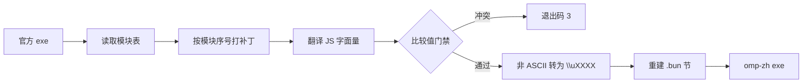

# 工作原理

omp 用 Bun 编译成单个 Windows 可执行文件，JavaScript 源码以模块表的形式打包在 PE 文件的 `.bun` 节里。omp-zh 不需要上游源码就能构建：读出模块表，改写其中一部分模块的源码，再按 Bun 的格式写回。

## 目录

| 路径 | 作用 |
|---|---|
| `build.js` | 构建入口：补丁 → 翻译 → 比较值门禁 → 重建 exe |
| `verify.js` | 运行 `verify/<版本>.js` 中的检查 |
| `lib/rebuild.js` | 解析 PE 与 Bun 模块表，重建 exe |
| `lib/translate.js` | JS 字面量扫描器与替换引擎 |
| `lib/dict.js` | 按固定顺序加载并去重字典 |
| `lib/bundle.js` | 读取模块、ASCII 转义、收集比较值 |
| `patches/<版本>.js` | 该版本的行为补丁（见 [patches.md](patches.md)） |
| `verify/<版本>.js` | 该版本的检查集 |
| `dict/` | 翻译字典（见 [dictionary.md](dictionary.md)） |
| `scripts/` | 下载、导出模块、扫描未译文字、发布、本机安装 |
| `test/` | 不依赖 omp 二进制的脚本测试 |
| `work/` | 下载的官方 exe、构建产物与报告（不入库） |

## 构建流程

1. `lib/rebuild.js` 找到 `.bun` 节，读出模块表。v18.13.3 有 3488 个模块：3083 个 JS 模块（其中 1065 个是 `chunks/cli-*.js` 代码分块），其余是 Markdown 提示词、HTML 模板、Python 脚本等资源。
2. `patches/<版本>.js` 按模块序号改写源码。
3. `lib/translate.js` 对每个 JS 模块应用字典。只有被改动的模块会写回，v18.13.3 约 300 个。
4. 门禁：字典里不允许出现代码用来比较的字面量（见 [dictionary.md](dictionary.md)）。
5. 改动过的模块里，所有非 ASCII 字符写成 `\uXXXX`。Bun standalone 加载器按 latin1 解码模块源码，直接写 UTF-8 中文会显示为乱码。
6. 重建 exe。

## 模块表与字节码

Bun 1.4 起，每个模块除了 JS 源码还带有预编译字节码，运行时优先执行字节码。只改源码而不处理字节码，改动不会生效。

`lib/rebuild.js` 的做法：

- 被改动模块的字节码偏移和长度清零，运行时回退执行该模块的源码。未改动的模块继续使用字节码。
- 新的模块源码追加在原模块表的位置，模块表整体后移；`[数据起点, 原模块表)` 之间的字节保持不变。这一段里有大量指向自身的绝对偏移和全部模块共享的字节码区，任何移动或写入都会让运行时崩溃。
- 模块表之后的尾部区域、启动参数、偏移表与结束标记依次后移，PE 节大小和映像大小按新长度重算。

不做任何修改时，重建结果与官方 exe 逐字节相同。上游升级 Bun 后，第一步就是确认这一点（见 [updating.md](updating.md) 第 2 步）。

## 可复现性

构建只依赖三样输入：官方 exe、`dict/`、`patches/<版本>.js`。字典按文件名排序加载，补丁与翻译都是确定性的字符串替换，所以同样的输入总会产出同样的字节。Releases 中每个版本都附有 `SHA256SUMS.txt`，可以用自己构建的结果对照。

## 检查集

`verify/<版本>.js` 对构建产物做以下几类检查：

- 结构：模块数、模块表长度、启动参数中的版本号。
- 补丁：每处补丁的新文本存在，原锚点文本不存在。
- 门禁回归：枚举键、HTTP 头、字符串匹配实参保持英文；三元表达式和数组里的界面文字仍被翻译。
- 模型可见文本：工具结果保持英文，外部导入的译文不出现在工具、代理与提供商源码段内。
- 运行：`--version` 输出正确，`--help` 含足量中文。

检查集也要能识别坏产物：用官方 exe 运行时，补丁和翻译相关的检查应当失败。
